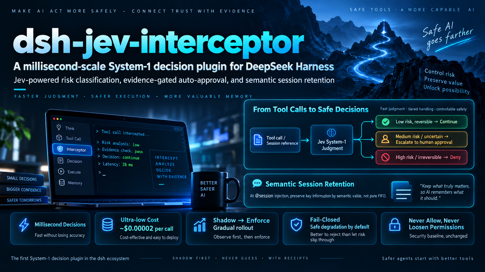
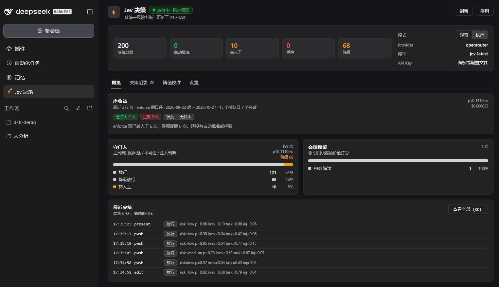
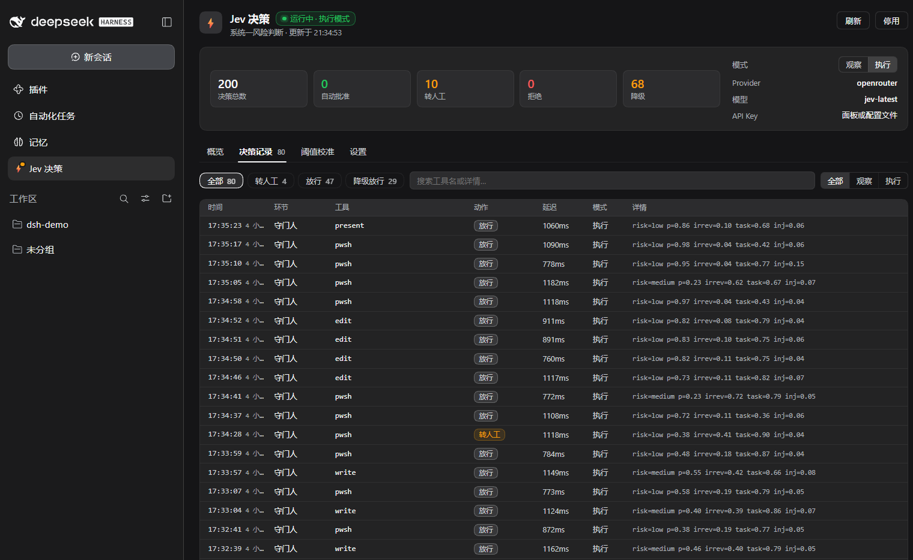
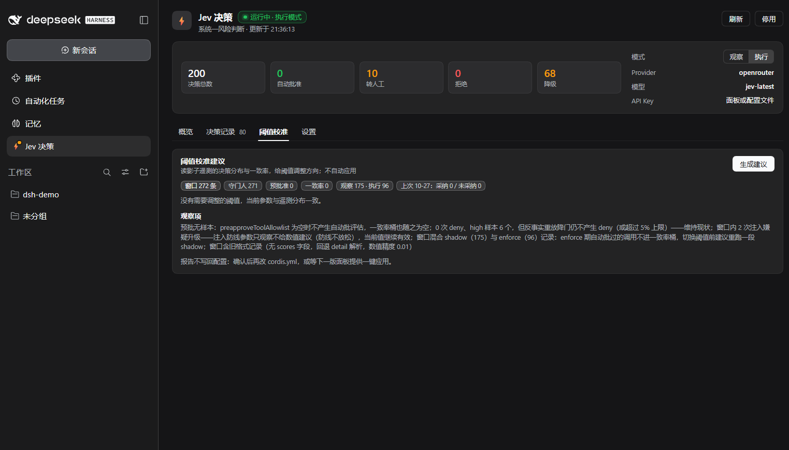
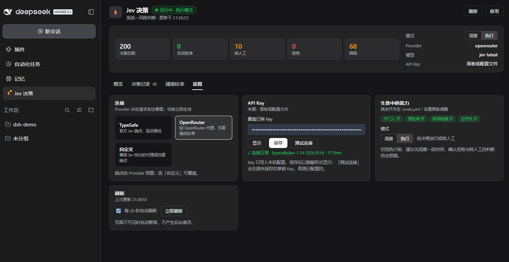

# dsh-jev-interceptor

[](https://github.com/AskTheWay/dsh-jev-interceptor/actions/workflows/ci.yml)
[](https://www.npmjs.com/package/dsh-jev-interceptor)
[](LICENSE)
[]()
[](https://github.com/topics/dsh-plugin)
[](https://typesafe.ai)

> ⚡ **Millisecond judgement for every tool call and every recalled message — for about two millionths of a dollar each.**
>
> Your agent's most expensive habits: asking a poetry-writing LLM yes/no questions, and amputating your context by *age*. This plugin wires [Jev](https://typesafe.ai) — the non-generative "System One" model that broke everyone's feed — into the decision points of [DeepSeek Harness](https://github.com/deepseek-ai/deepseek-harness) where an LLM is overkill and rules are blind.

English | [中文](README.zh.md)





<p align="center">
  
  
  
</p>

> The Web panel (sidebar ⚡ → Jev 决策): live KPIs and net-benefit card, a filterable decision log with full evidence per row, shadow-data threshold advice that tracks whether you adopted it, and one-click connection test. Every screenshot above is the real plugin running real decisions.

**What it does, in one breath:** before a tool call runs, Jev classifies its risk, irreversibility, task-fit, and injection-suspicion in one ~$0.00002 request — confident high-risk calls get denied, medium ones escalate to a human, and clearly-granted reversible ones stop wasting your clicks on approval dialogs. And when an `@session` snapshot gets injected, Jev scores every message's value for the citing task so the **error traceback survives the byte budget instead of the oldest small talk**. Every doubt, every timeout, every missing key degrades to stock dsh behavior. Nothing to configure away, nothing that can widen a permission.

## Why this exists

dsh ships **zero per-call risk classification** — the pre-execute waterfall's default is a bare `allow`. Its only built-in precedent, `experimental/auto-review`, does the classification with a *generative* LLM: one full model request per tool call, temperature 0, hand-rolled JSON text protocol, self-described as slow, expensive, and experimental. That's a System-2 scribe doing a System-1 reflex's job:

| | auto-review (generative LLM) | dsh-jev-interceptor (Jev) |
|---|---|---|
| Decision shape | emits JSON token-by-token, then parses it and prays | typed `choice`/`noul` answers — type errors are structurally impossible |
| Cost per call | one **full LLM request** | **~$0.00002** (measured: 501 input tokens) |
| Latency | seconds | ~100ms provider-side (TypeSafe-reported p50); ~1s end-to-end from outside US-West |
| Uncertainty | buried in prose | per-question probability distributions + calibrated confidence |
| Failure path | parse fallback → deny | low confidence → `next()` — **it never guesses** |

Jev's maker TypeSafe reports up to **200× faster / 400× cheaper** than LLMs on classification workflows — and this plugin is that number, landed in a real agent harness, with receipts in `/jev-stats`.

We believe this is the **first System-1 decision plugin in the dsh ecosystem**. The full map of where decision models fit in dsh — this plugin's two hooks plus eleven more verified hooks (semantic model routing, context-retention scoring, image-offload pre-planning, worker-report verification...) — is in [docs/jev-usage-points.md](docs/jev-usage-points.md).

## The FIFO pain point nobody talks about

When you `@`-mention a past session in dsh, the harness injects a bounded snapshot of it — and when that snapshot exceeds its byte budget, it drops messages **oldest-first**. Pure FIFO. Zero semantics. The bug report you pasted at the top of the session and the three-line question that started it all? Dropped first. The "thanks!" and "ok, continue"? Kept — they were newer.

dsh's own retention code is honest about it: drop the oldest, then truncate the longest, done. This plugin's `jev-session-reference` row takes that decision over (by subclassing the upstream resolver, so `@`-completion, budgets, spill, and cancellation stay inherited): one Jev fan-out scores each droppable message — *noise / background / relevant / critical* — and the drop order becomes **least valuable first**, with truncation cutting padding before substance. Checkpoints and the newest message stay protected exactly as upstream; the byte budget is honored exactly as upstream; and with `sessionReferenceEnabled: false` (the default) the row renders **byte-for-byte like stock**.

In shadow mode you get the receipts before trusting it: every injection logs the counterfactual — which messages FIFO dropped that scoring would have kept — then flip to `enforce`.

## The 60-second tour

```sh
dsh plugin --profile <name> add dsh-jev-interceptor
```

```yaml
# in your profile's cordis.patch.yml
- id: jev-interceptor
  name: dsh-jev-interceptor
  config:
    enabled: true
    mode: shadow            # watch mode first: records every decision, enforces nothing
    provider: typesafe      # or 'openrouter' (works today, no waitlist) | 'custom'
```

**No YAML needed.** Once installed, control everything from the chat box — commands persist to the profile and take effect on the next tool call, no reload:

```
/jev-on                 # enable (starts in shadow mode — records, never acts)
/jev-stats              # watch what it decides, with full probability distributions
/jev-log 20 --json      # the last N decisions, one per line; --json/--csv export
/jev-impact             # the bottom line: clicks saved, denials, cost, latency
/jev-calibrate          # shadow-data threshold advice (never auto-applies)
/jev-mode enforce       # promote once the numbers look right
/jev-off                # back to stock behavior
```

Use your agent normally. In shadow mode every decision lands in telemetry with its full probability distribution; `/jev-stats` summarizes:

```
[guard] calls: 41  degraded: 0  cached: 9
  actions: delegate=33 ask=6 deny=2
  input tokens: 18234  est. cost: $0.000766
  latency: p50 247ms  p95 512ms  max 611ms
```

Happy with the numbers? Flip `mode: enforce`. That's the whole rollout plan — **shadow first, then trust, never guess**.

## Receipts (real usage, not benchmarks)

Five weeks of dogfooding (2026-09-22 → 10-27, 15 active days, 7 sessions, 272 decisions — `/jev-impact` renders this from your own telemetry any time):

- the pre-approve path never fired, so the mis-approval metric has **no samples yet** (0/0, honestly rendered as "无样本" rather than "0") — what *was* exercised: 6 uncertain calls escalated to the human, 0 high-risk calls missed
- total decision cost: **$0.0068** (162,425 input tokens across 143 billed decisions; p50 1110ms, p95 1503ms — the screenshots above are this same window)
- 128 decisions degraded to stock behavior (no key for most of the window, 9 timeouts) at **zero behavioral cost** — the fail-closed posture doing exactly what it promises

Calibration closes its own loop: every `/jev-calibrate` run snapshots the report; the next run tells you which of its previous suggestions you adopted (`✓ 已采纳`), ignored, or manually overrode (`↔`), and how the agreement buckets moved since.

## Safety model (the part you should actually read)

- **Never `allow`.** "No objection" is expressed as `next()`, so downstream listeners (external hooks, auto-review) keep their veto.
- **Fail-closed everywhere.** No key / provider cooldown / timeout / parse mismatch / internal error → delegate to stock behavior. The approval service's `never` policy is enforced upstream of every listener, so this plugin structurally cannot relax it.
- **Evidence-gated auto-approval.** `allowed-once` requires captured argument evidence: only a call the guard escalated (fresh pending entry, matching session and tool) can be auto-approved. Hook asks and sandbox escalations carry no arguments and always go to the human.
- **Injection-aware.** Tool arguments enter the Jev `state` data field only; `instructions` are fixed strings; a suspected-injection answer *escalates* rather than suppresses. (Jev's maker acknowledges adversarial inputs can sway classifiers — so denial here is an accelerator, never the last line of defense.)
- **Bounded input.** Head+tail argument previews and trailing-message digests — Jev's own guidance is to filter in code and send only what a question needs.
- **Resilient by construction.** Wall-clock timeout per attempt, single retry on 429/529, cooldown after consecutive failures (timeouts count), concurrency cap, LRU decision cache, queue-bound semaphore. A dead provider costs you zero behavior, not your harness.
- **Takeover rows disable as a layer.** The `jev-session-reference` row replaces the upstream `session-reference` row; toggling only this row off in the Plugins UI would leave *no* session-reference active. Remove the takeover by disabling the whole `dsh-jev-interceptor` bundle layer (`setBundleEnabled(false)`), which restores the upstream row.
- **Explainable enforcement.** Every `ask`/`deny` carries a human-readable reason with the full evidence summary (`jev-guard: 中风险调用，需人工确认（risk=medium 0.72 · irrev=0.30 · inj=0.01）`) straight into the approval card and the denied tool result. The `jev-guard:` prefix is a safety protocol — the pre-approver refuses to auto-approve its sibling's escalations.
- **Observable.** Every decision lands in `<dsh-home>/plugins/dsh-jev-interceptor/telemetry.jsonl` (honoring `$DSH_HOME`), with `callId` correlation and full-precision `scores` for calibration replays; the log rotates at 20 MB. `/jev-stats` aggregates per hook, `/jev-log` shows per-decision detail, and the Web panel charts it all.
- **Calibratable, not guessed.** `/jev-calibrate` replays your shadow telemetry through the *same* decision matrix and suggests threshold moves (±0.05 steps, ≥30 samples for routine moves — ≥10 once a mis-approval danger signal appears, tighten-only; injection thresholds never relaxed, nothing auto-applied).

All of this is enforced by **130 tests**, including adversarial-review regression cases (a concurrency leak that could hang the tool pipeline, cross-session callId collisions, evidence-free auto-approval).

## Configure

Everything is a config field — timeouts, cooldown, concurrency, cache, per-hook thresholds, tool lists — see the `Config` schema in `src/config.ts`. Notable defaults:

- read-only tools (`read`, `read_image`, `grep`, `glob`, `todo_write`) short-circuit with **zero cost**;
- the Auto permission preset is left entirely to `auto-review` (no double review, no double billing);
- the pre-approval allowlist starts **empty** — until you name tools in `preapproveToolAllowlist`, nothing is ever auto-approved.

**Stagnation detection** (v0.5, opt-in, default off) — dsh's repeat-tool-reminder only catches *exact* repeats; a doomed retry loop that varies its arguments is invisible to it. When the same tool fails ≥4 times with different arguments, one Jev fan-out judges "no progress + same failure mode"; on high confidence (enforce mode only — shadow logs the would-be alert in telemetry) a plugin-notice reminder tells the agent to stop and change strategy (observe-and-enrich — never vetoes a result):

```yaml
    stagnationEnabled: true        # default false
    stagnationTriggerCount: 4      # failed varied attempts before judging
    stagnationConfidenceMin: 0.85  # both nouls must clear this to alert
    stagnationCooldownMs: 300000   # one alert per 5 minutes per tool
```

Semantic session retention lives on its own row (disabled and byte-for-byte stock until you arm it):

```yaml
- id: jev-session-reference
  config:
    sessionReferenceEnabled: true   # false (default) = pure passthrough
    mode: shadow                    # records would-be retention, renders stock FIFO
    provider: openrouter
    apiKeyEnv: OPENROUTER_API_KEY
```

OpenRouter works today with no waitlist (decisions models live on a dedicated endpoint there):

```yaml
    provider: openrouter
    apiKeyEnv: OPENROUTER_API_KEY
```

The client speaks the plain `state + questions` wire shape shared by TypeSafe direct, OpenRouter, and the Apache-2.0 local alternative [Laya](https://huggingface.co/convaiinnovations/laya) — providers stay swappable, and a closed provider never becomes a lock-in.

## Development

```sh
npm install --legacy-peer-deps   # devDeps pin a current dsh API generation
npm run typecheck                # src + tests, against real @deepseek-ai types
npm test                         # vitest, 130 tests, no network
npm run build                    # tsc -> lib/
node scripts/smoke.mjs           # one real decision against a live provider
```

## Roadmap

The approval loop (v0.1), semantic session retention (v0.2), image-offload pre-planning (v0.4), and stagnation detection (v0.5) are in. The verified next frontiers — where selection, not just safety, meets System-1 ([full catalog](docs/jev-usage-points.md)):

- **Content-aware model routing** — routine steps on the cheap route, deep work on the strong one
- **Worker-report verification** — when a subagent says "done", something checks

## License

[MIT](LICENSE)
